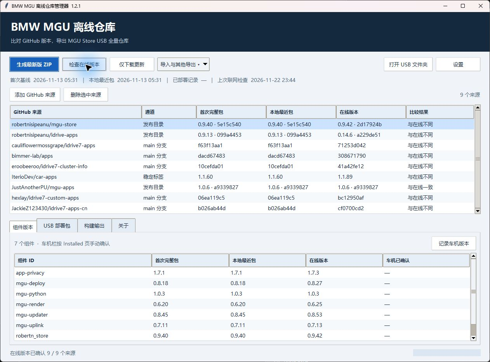

# BMW MGU Offline Manager

**BMW MGU 离线仓库管理器**  
在 Windows 上整理软件源、比较版本，制作 MGU Store 全量与增量 USB 部署包。

[下载 Windows 版](https://github.com/SleepyK911/BMW-MGU-Offline-Manager/releases/latest) · [功能](#功能) · [使用说明](#下载与开始使用) · [RideBili](https://github.com/SleepyK911/RideBili) · [致谢](#版权许可与致谢)

这个工具用于把电脑上的 GitHub 下载与版本整理工作，接到车机 MGU Store 的 USB 安装流程。适合车机联网不稳定、希望保留完整包作基线，或定期只带更新内容上车的使用方式。

## 界面预览

截图来自 1.2.1 的真实 Windows 界面。首次及本地包使用 2026-11-13 的公开仓库快照，在线列由截图时查询得到。图中版本仅用于展示当时状态。

## 功能

| 功能 | 使用方式 |
| :--- | :--- |
| 本地与上游版本对比 | 并排查看首次完整包、本地最近包和在线版本，展开来源可查看各组件 |
| 全量离线 ZIP | 按当前来源列表下载并校验，导出 `mgu-repo` USB 仓库 |
| 仅下载更新 | 对照已确认的车机部署记录，挑选新增、较新或同版本内容变化的组件，并查找可用依赖 |
| 来源管理 | 添加或删除 GitHub 仓库，自动识别发布目录或默认分支，也可手选稳定标签与分支 |
| 部署记录 | 从完整包或增量包中选择车机实际装好的组件，作为下次更新的比较依据 |
| USB 包管理 | 部署 ZIP 存入 EXE 同目录的 `USB`，可在界面列出、回读版本并记录部署 |
| 缓存与代理 | 复用已下载内容，支持 HTTP 代理；缓存完整时可离线重新导出 |
| 文件校验 | 发布包校验长度与 SHA-256，ZIP 生成后复核完整性，可附加全库校验清单 |

公开分支和标签优先通过 Git HTTPS 查询，REST API 作为备用。公开发布目录通过 GitHub Release 下载。网络或限流仍可能影响查询，程序会显示失败原因及缓存状态。

## 下载与开始使用

1. 从 [最新发布页](https://github.com/SleepyK911/BMW-MGU-Offline-Manager/releases/latest) 下载 `BMW_MGU_Offline_Manager_1.2.1_Windows_x64.zip`。
2. 解压到可写入的文件夹，双击 `BMW_MGU_Offline_Manager.exe`。保留旁边的 `_internal` 文件夹。便携包已包含 Python、Tk 和 Node.js。
3. 已有本工具生成的完整部署 ZIP 或 USB 目录时，使用「导入与其他导出」读取。首次完整导入或生成的包会成为固定基线。
4. 点击「检查在线版本」，或直接「生成最新版 ZIP」。导出结果位于 EXE 旁的 `USB` 文件夹。
5. 将部署 ZIP 解压到车机可读取的 U 盘根目录，确认根目录直接包含 `mgu-repo`。在车机 **MGU Store → USB** 中按需安装或更新。

电脑上的版本记录、设置和默认缓存存放在 `%LOCALAPPDATA%\BMW MGU Offline Manager`。升级时解压新版便携包即可沿用这些记录。在「设置」可指定已有缓存目录或 HTTP 代理，GitHub API 可选读取 `GITHUB_TOKEN` 环境变量。

### 后续只下载有更新的组件

在「USB 部署包」选中已经用于车机的全量包，点「记录已部署」，按车机 **Installed** 页勾选实际装好的组件。之后点「仅下载更新」生成增量 ZIP。车机更新完成后，再为该增量包记录实际装好的组件。

发布目录仅下载选入的组件包。源码型仓库在提交改变且本地没有缓存时，仍需取得仓库快照进行比较，并保留源码构建所需的文件。增量 USB 的清单列出选中的组件。未在当前来源中找到的依赖会写入构建输出，安装时仍由 Store 检查。

将增量 ZIP 解压到干净的 U 盘目录，避免旧全量目录混入。生成或解压包后，在车机完成安装，再保存部署记录。相同版本号但内容改变的组件可能被电脑选入增量包，车机是否提示更新取决于 Store 的版本与来源判断。

### 网络不稳定时

「生成最新版 ZIP」需要当前全部来源在本次核实成功。失败时保留已有 ZIP，并在构建输出说明原因。「离线缓存导出 ZIP」可使用此前已下载齐全的缓存，报告会标明缓存状态。「写入 USB / 文件夹」逐来源更新，失败来源保留目标中已有内容。

## 与 RideBili 配合

[RideBili](https://github.com/SleepyK911/RideBili) 是同一维护者的 BMW iDrive 7 / MGU 哔哩哔哩客户端。可在本管理器点「添加 GitHub 来源」，输入 `SleepyK911/RideBili` 或粘贴其仓库主页，选择 **发布目录（catalog）**，再生成 USB 部署包。

管理器负责电脑端下载、版本与打包，RideBili 在车机运行。RideBili 的 [安装说明](https://github.com/SleepyK911/RideBili#安装与使用) 提供其依赖、安装方法和适用环境。

## 初始来源

以下为初始配置，可按需增删。每个来源按自己的通道发布，组件数量和版本会随上游变化。

| GitHub 来源 | 通道 |
| :--- | :--- |
| [robertnisipeanu/mgu-store](https://github.com/robertnisipeanu/mgu-store) | 发布目录 |
| [robertnisipeanu/idrive-apps](https://github.com/robertnisipeanu/idrive-apps) | 发布目录 |
| [cauliflowermossgrape/idrive7-apps](https://github.com/cauliflowermossgrape/idrive7-apps) | main 分支 |
| [bimmer-lab/apps](https://github.com/bimmer-lab/apps) | main 分支 |
| [eroobeeroo/idrive7-cluster-info](https://github.com/eroobeeroo/idrive7-cluster-info) | main 分支 |
| [IterioDev/car-apps](https://github.com/IterioDev/car-apps) | 稳定标签 |
| [JustAnotherPU/mgu-apps](https://github.com/JustAnotherPU/mgu-apps) | 发布目录 |
| [hexlay/idrive7-custom-apps](https://github.com/hexlay/idrive7-custom-apps) | main 分支 |
| [JackieZ123430/idrive7-apps-cn](https://github.com/JackieZ123430/idrive7-apps-cn) | main 分支 |

应用 ID 和 `mgu-copy.json` 来源标识随 USB 保留。车机联网后，可以通过相同上游来源继续检查更新。同名组件可能出现在不同来源中，安装时需要确认来源和车机兼容性。

## 开发与反馈

源码在 [app](app)，Windows 打包方法见 [构建说明](docs/BUILD.md)，版本变化见 [更新说明](docs/CHANGELOG.md)。

Windows 端已检查程序启动、署名和主界面。此前的全量、增量、缓存及部署记录有软件测试记录，车机安装与插件运行需在实际车辆上验证。

反馈时请提供管理器版本、来源及通道、操作步骤和错误文字。分享日志或截图前请移除令牌、代理凭据和个人路径。

## 版权、许可与致谢

**© 2026 Kan Ning 及本项目贡献者。** 此署名对应本项目原创的管理界面、仓库管理逻辑和文档，第三方软件及插件的著作权归各自权利人。

本项目按 **[GPL-3.0-or-later](LICENSE)** 发布。随附原作者的 `mgu-install.js`、许可证和来源说明，Windows 运行时及打包工具的第三方条款见 [THIRD_PARTY_NOTICES.md](THIRD_PARTY_NOTICES.md) 与 [licenses](licenses)。下载的插件遵循各自项目许可。

| 项目 | 致谢 |
| :--- | :--- |
| [MGU Store · Robert Nisipeanu 及贡献者](https://github.com/robertnisipeanu/mgu-store) | 车机安装平台、USB 仓库格式、来源标识和官方 `usb-repo` 打包工具 |
| [Python](https://www.python.org/)、[Tcl/Tk](https://www.tcl-lang.org/) | Windows 管理界面与程序运行时 |
| [Node.js](https://nodejs.org/) | 电脑端运行上游 `mgu-install.js` |
| [PyInstaller](https://pyinstaller.org/) | Windows 便携版打包 |
| 上表各软件源的作者与贡献者 | 插件、工具及其发布维护 |

开发过程使用了 ChatGPT / Codex 辅助。上游作者的代码、发布物和署名按原许可保留。

本工具是独立社区项目，与 BMW 官方及上游项目无隶属、授权或背书关系。BMW、iDrive 等商标归各自权利人。软件按现状提供，车机兼容性、插件稳定性与回退能力取决于实际环境。

English overview

BMW MGU Offline Manager is a Windows desktop utility maintained by Kan Ning. It compares local snapshots with GitHub sources, creates full or incremental MGU Store USB repositories, and tracks user-confirmed deployments. Portable Windows releases include their runtime dependencies. Generated ZIPs are saved in the `USB` folder next to the executable. Release sources download selected artifacts for incremental exports, while source-built projects may require a repository snapshot. The interface is currently in Chinese. Related project [RideBili](https://github.com/SleepyK911/RideBili) can be added as a catalog source. Independent community project. GPL-3.0-or-later, with upstream and third-party notices preserved.

